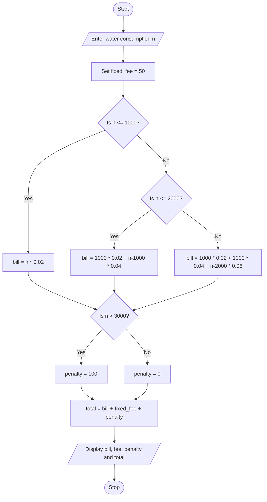

### Case Study 25: Water Tariff Analysis

### 1\. Problem Statement

Write a Python program to calculate the water bill based on water consumption in litres. The cost is ₹0.02 per litre for the first 1000 litres, ₹0.04 per litre for the next 1000 litres, and ₹0.06 per litre for consumption above 2000 litres. A fixed fee of ₹50 is added to every bill. If water consumption exceeds 3000 litres, a penalty of ₹100 is charged. Calculate and display the water bill, fixed fee, penalty, and total bill.

### 2\. Algorithm

* Start.

* Read water consumption in litres (`n`).

* Set the fixed fee to ₹50.

* Calculate the water bill using the applicable consumption slabs.

* If consumption exceeds 3000 litres, set the penalty to ₹100; otherwise, set it to ₹0.

* Calculate the total bill by adding the water bill, fixed fee, and penalty.

* Display the water consumption, water bill, fixed fee, penalty, and total bill.

* Stop.

### 3\. Flowchart (Mermaid code)




### 4\. Python Source Code

```python

# Case Study 25: Water Tariff Analysis

n = int(input("Enter water consumption in litres: "))

fixed_fee = 50

if n <= 1000:
    bill = n * 0.02
elif n <= 2000:
    bill = 1000 * 0.02 + (n - 1000) * 0.04
else:
    bill = 1000 * 0.02 + 1000 * 0.04 + (n - 2000) * 0.06

if n > 3000:
    penalty = 100
else:
    penalty = 0

total = bill + fixed_fee + penalty

print("Water Consumption:", n, "litres")
print("Water Bill:", bill)
print("Fixed Fee:", fixed_fee)
print("Penalty:", penalty)
print("Total Bill:", total)
```

### 5\. Sample Input

```text
Enter water consumption in litres: 3500
```

### 6\. Sample Output

```text
Water Consumption: 3500 litres
Water Bill: 170.0
Fixed Fee: 50
Penalty: 100
Total Bill: 320.0
```

### 7\. Calculation for the Sample

For 3500 litres:

* First 1000 litres:

* Next 1000 litres:

* Remaining 1500 litres:

* Water bill:

* Fixed fee: ₹50

* Penalty: ₹100

Total bill = ₹150 + ₹50 + ₹100 = ₹300.

Correction: The correct sample output is:

```text
Water Consumption: 3500 litres
Water Bill: 150.0
Fixed Fee: 50
Penalty: 100
Total Bill: 300.0
```
