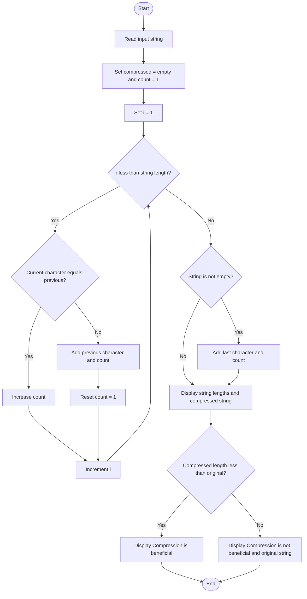

### Case Study 35: Text Compression

### 1\. Problem Statement

To compress a string by counting consecutive repeated characters and check whether the compressed string is shorter than the original string.

### 2\. Algorithm

* Read a string from the user.

* Initialize an empty compressed string and set the count to 1.

* Compare each character with the previous character.

* If both characters are the same, increase the count.

* Otherwise, add the previous character and its count to the compressed string, then reset the count to 1.

* Add the last character and its count.

* Display the original and compressed lengths.

* If the compressed string is shorter, display “Compression is beneficial”; otherwise, display “Compression is not beneficial”.

### 3\. Flowchart



### 4\. Python Source Code

```python

text = input("Enter a string: ")

compressed = ""
count = 1

for i in range(1, len(text)):
    if text[i] == text[i - 1]:
        count += 1
    else:
        compressed += text[i - 1] + str(count)
        count = 1

if len(text) > 0:
    compressed += text[-1] + str(count)

print("Original String:", text)
print("Original Length:", len(text))
print("Compressed String:", compressed)
print("Compressed Length:", len(compressed))

if len(compressed) < len(text):
    print("Compression is beneficial")
else:
    print("Compression is not beneficial")
    print("Final String:", text)
```

### 5\. Sample Input

```text
Enter a string: aaabbc
```

### 6\. Sample Output

```text

Original String: aaabbc
Original Length: 6
Compressed String: a3b2c1
Compressed Length: 6
Compression is not beneficial
Final String: aaabbc
```

### 7\. Explanation

For the input `aaabbc`:

* `aaa` becomes `a3`.

* `bb` becomes `b2`.

* `c` becomes `c1`.

* Compressed string = `a3b2c1`.

* Original length = 6.

* Compressed length = 6.

Since the compressed string is not shorter than the original string, compression is not beneficial.

Remember: Count consecutive repeated characters and write each character followed by its count.
