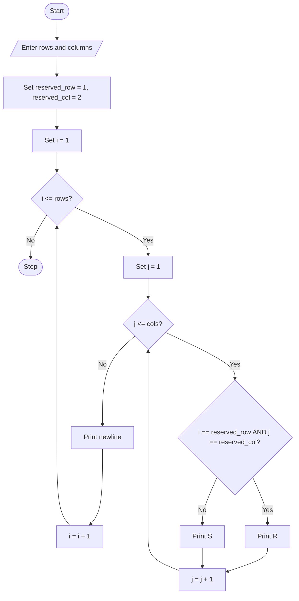

### Case Study 26: Examination Seating

### 1\. Problem Statement

Write a Python program to display an examination seating arrangement using rows and columns. The user enters the number of rows and columns. The program displays `S` for a student seat and `R` for the reserved seat. The reserved seat is located at row 1, column 2.

### 2\. Algorithm

* Start.

* Read the number of rows and columns.

* Set `reserved_row = 1` and `reserved_col = 2`.

* Use an outer loop to traverse each row.

* Use an inner loop to traverse each column.

* If the current row and column match the reserved seat, print `R`; otherwise, print `S`.

* Move to the next line after each row.

* Stop.

### 3\. Flowchart (Mermaid Code)



### 4\. Python Source Code

```python

# Case Study 26: Examination Seating

rows = int(input("Enter number of rows: "))
cols = int(input("Enter number of columns: "))

reserved_row = 1
reserved_col = 2

for i in range(1, rows + 1):
    for j in range(1, cols + 1):
        if i == reserved_row and j == reserved_col:
            print("R", end="  ")
        else:
            print("S", end="  ")
    print()
```

### 5\. Sample Input

```text
Enter number of rows: 3
Enter number of columns: 4
```

### 6\. Sample Output

```text
S  R  S  S
S  S  S  S
S  S  S  S
```

### 7\. Explanation

* `rows` and `cols` specify the seating arrangement size.

* The outer `for` loop controls the rows.

* The inner `for` loop controls the columns.

* `if` checks whether the current seat is the reserved seat.

* `R` represents the reserved seat, and `S` represents a student seat.

* `end=" "` prints seats on the same line, while `print()` moves to the next row.
*
