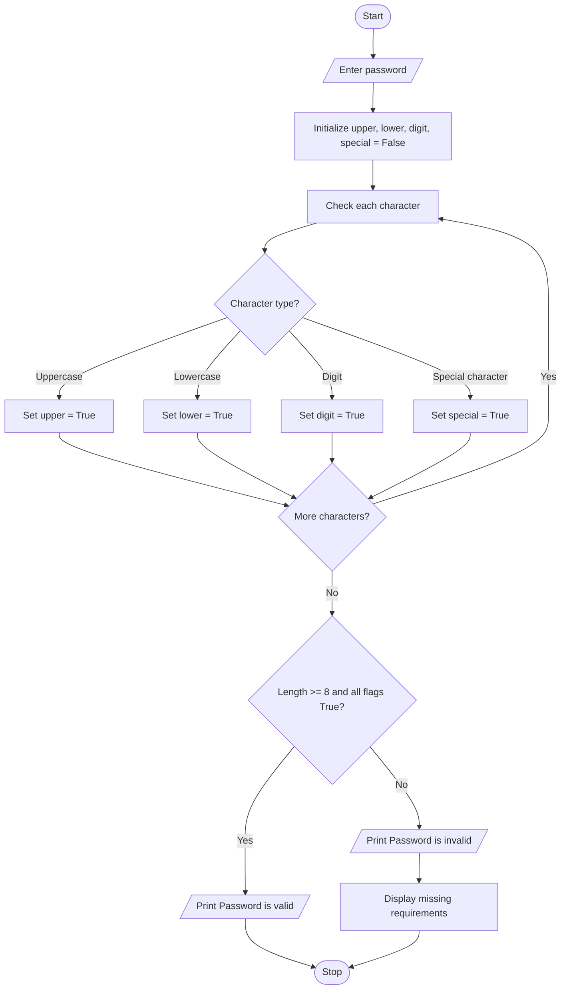

### Case Study 29: Password Validation

### 1\. Problem Statement

Write a Python program to validate a password based on certain conditions. The password must contain at least 8 characters, one uppercase letter, one lowercase letter, one digit, and one special character. If the password does not satisfy these conditions, display an appropriate error message for each missing requirement.

### 2\. Algorithm

* Start.

* Read a password from the user.

* Initialize `upper`, `lower`, `digit`, and `special` as `False`.

* Traverse each character in the password.

* Check whether the character is uppercase, lowercase, a digit, or a special character.

* If the password has at least 8 characters and satisfies all conditions, print “Password is valid”.

* Otherwise, print “Password is invalid” and display the missing requirements.

* Stop.

### 3\. Flowchart (Mermaid Code)



### 4\. Python Source Code

```python

# Case Study 29: Password Validation

password = input("Enter a password: ")

upper = False
lower = False
digit = False
special = False

for ch in password:
    if ch.isupper():
        upper = True
    elif ch.islower():
        lower = True
    elif ch.isdigit():
        digit = True
    else:
        special = True

if len(password) >= 8 and upper and lower and digit and special:
    print("Password is valid")
else:
    print("Password is invalid")

    if len(password) < 8:
        print("Password must contain 8 characters")
    if not upper:
        print("Add an uppercase letter")
    if not lower:
        print("Add a lowercase letter")
    if not digit:
        print("Add a digit")
    if not special:
        print("Add a special character")
```

### 5\. Sample Input

```text
Enter a password: hello123
```

### 6\. Sample Output

```text
Password is invalid
Add an uppercase letter
Add a special character
```

### 7\. Explanation

* `input()` reads the password entered by the user.

* The four Boolean variables track whether the password contains the required character types.

* `isupper()` checks for uppercase letters.

* `islower()` checks for lowercase letters.

* `isdigit()` checks for digits.

* The `else` block marks any other character as a special character.

* `len(password) >= 8` checks the minimum length.

* If all conditions are satisfied, the password is valid; otherwise, the program displays the missing requirements.
*
