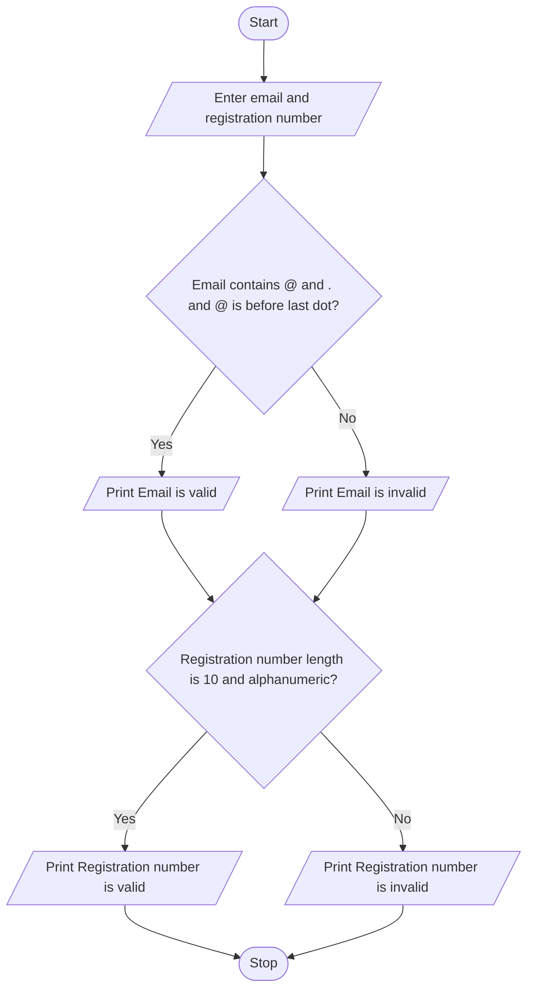

### Case Study 30: Student Email and Identifier Validation

### 1\. Problem Statement

Write a Python program to validate a student's email address and registration number. The email must contain `@` and `.`, with `@` appearing before the last dot. The registration number must contain exactly 10 alphanumeric characters. Display whether each input is valid or invalid.

### 2\. Algorithm

* Start.

* Read the student's email and registration number.

* Check whether the email contains `@` and `.`, and whether `@` appears before the last dot.

* If the conditions are satisfied, print “Email is valid”; otherwise, print “Email is invalid”.

* Check whether the registration number has exactly 10 characters and contains only letters and digits.

* If the conditions are satisfied, print “Registration number is valid”; otherwise, print “Registration number is invalid”.

* Stop.

### 3\. Flowchart (Mermaid Code)



### 4\. Python Source Code

```python

# Case Study 30: Student Email and Identifier Validation

email = input("Enter student email: ")
reg_no = input("Enter registration number: ")

if "@" in email and "." in email and email.index("@") < email.rindex("."):
    print("Email is valid")
else:
    print("Email is invalid")

if len(reg_no) == 10 and reg_no.isalnum():
    print("Registration number is valid")
else:
    print("Registration number is invalid")
```

### 5\. Sample Input

```text
Enter student email: student@gmail.com
Enter registration number: AB12345678
```

### 6\. Sample Output

```text
Email is valid
Registration number is valid
```

### 7\. Explanation

* `input()` reads the email and registration number.

* `"@" in email` checks whether the email contains `@`.

* `"." in email` checks whether the email contains a dot.

* `email.index("@") < email.rindex(".")` checks whether `@` appears before the last dot.

* `len(reg_no) == 10` checks whether the registration number has exactly 10 characters.

* `reg_no.isalnum()` checks whether it contains only letters and digits.

* The `if-else` statements display the appropriate validation messages.

