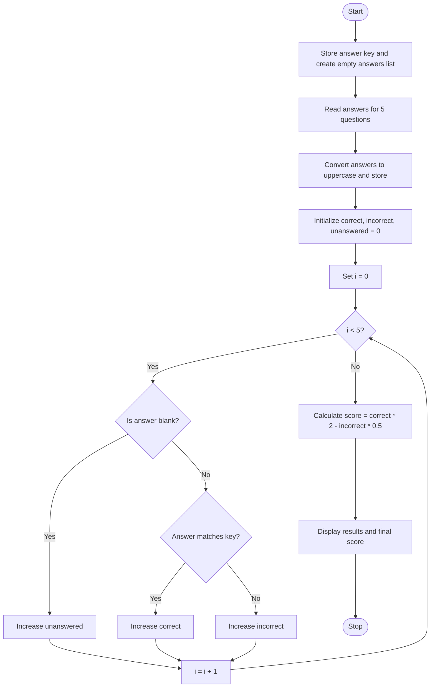

### Case Study 31: Examination Answer Evaluation

### 1\. Problem Statement

Write a Python program to evaluate a student's examination answers using a predefined answer key. The program accepts answers for five questions. Each correct answer receives 2 marks, each incorrect answer deducts 0.5 marks, and unanswered questions receive no marks. Finally, display the number of correct, incorrect, and unanswered questions along with the final score out of 10.

### 2\. Algorithm

* Start.

* Store the correct answers in `answer_key`.

* Create an empty list called `answers`.

* Read answers for five questions and store them in uppercase.

* Initialize `correct`, `incorrect`, and `unanswered` to zero.

* Compare each answer with the answer key.

* If the answer is blank, increase `unanswered` by 1.

* If the answer is correct, increase `correct` by 1; otherwise, increase `incorrect` by 1.

* Calculate the score using `correct × 2 − incorrect × 0.5`.

* Display the results and final score.

* Stop.

### 3\. Flowchart (Mermaid Code)



### 4\. Python Source Code

```python

# Case Study 31: Examination Answer Evaluation

answer_key = ["A", "B", "C", "D", "A"]
answers = []

for i in range(5):
    ans = input("Enter answer for question " + str(i + 1) + " (A/B/C/D or blank): ")
    answers.append(ans.upper())

correct = 0
incorrect = 0
unanswered = 0

for i in range(5):
    if answers[i] == "":
        unanswered += 1
    elif answers[i] == answer_key[i]:
        correct += 1
    else:
        incorrect += 1

score = (correct * 2) - (incorrect * 0.5)

print("\n--- Examination Result ---")
print("Correct Answers:", correct)
print("Incorrect Answers:", incorrect)
print("Unanswered Questions:", unanswered)
print("Final Score:", score, "out of 10")
```

### 5\. Sample Input

```text
Enter answer for question 1 (A/B/C/D or blank): A
Enter answer for question 2 (A/B/C/D or blank): B
Enter answer for question 3 (A/B/C/D or blank): A
Enter answer for question 4 (A/B/C/D or blank): D
Enter answer for question 5 (A/B/C/D or blank):
```

### 6\. Sample Output

```text
--- Examination Result ---
Correct Answers: 3
Incorrect Answers: 1
Unanswered Questions: 1
Final Score: 5.5 out of 10
```

### 7\. Explanation

* `answer_key` stores the correct answers.

* `answers` stores the student's responses.

* `append()` adds each answer to the list.

* `upper()` converts lowercase answers into uppercase.

* The first `for` loop collects answers for five questions.

* The second `for` loop checks each answer and counts correct, incorrect, and unanswered questions.

* The score is calculated by awarding 2 marks for each correct answer and deducting 0.5 marks for each incorrect answer.
