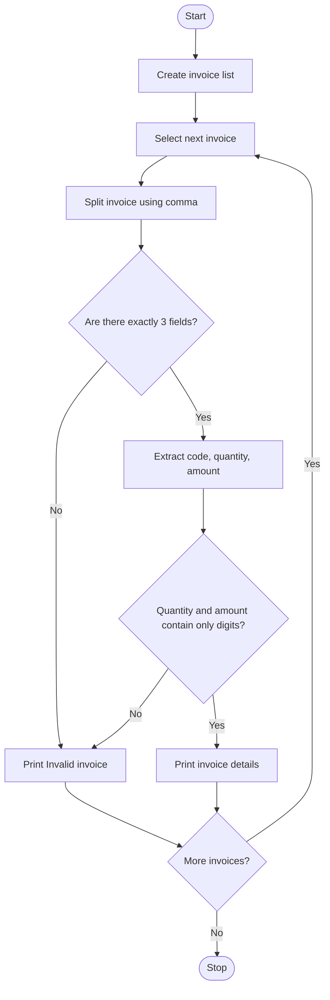

### Case Study 32: Invoice Data Extraction

### 1\. Problem Statement

Write a Python program to extract product codes, quantities, and amounts from invoice records. Each invoice is stored as a string containing three values separated by commas. The program checks whether each invoice contains exactly three fields and whether the quantity and amount contain only digits. If the invoice is valid, display its details; otherwise, display an invalid invoice message.

### 2\. Algorithm

* Start.

* Create a list of invoice records.

* Traverse each invoice using a `for` loop.

* Split each invoice into fields using `split(",")`.

* Check whether the invoice contains exactly three fields.

* Extract the product code, quantity, and amount.

* Check whether the quantity and amount contain only digits.

* If valid, display the invoice details; otherwise, display an invalid invoice message.

* Repeat until all invoices are checked.

* Stop.

### 3\. Flowchart (Mermaid Code)



### 4\. Python Source Code

```python

# Case Study 32: Invoice Data Extraction

invoices = [
    "P101,2,500",
    "P102,3,900",
    "P103,1,250",
    "P104,abc,400"
]

for invoice in invoices:
    data = invoice.split(",")

    if len(data) == 3:
        code = data[0]
        quantity = data[1]
        amount = data[2]

        if quantity.isdigit() and amount.isdigit():
            print("\nProduct Code:", code)
            print("Quantity:", quantity)
            print("Amount:", amount)
        else:
            print("\nInvalid invoice:", invoice)
    else:
        print("\nInvalid invoice:", invoice)
```

### 5\. Sample Input

The program uses predefined invoice records, so no user input is required.

```text
P101,2,500
P102,3,900
P103,1,250
P104,abc,400
```

### 6\. Sample Output

```text
Product Code: P101
Quantity: 2
Amount: 500

Product Code: P102
Quantity: 3
Amount: 900

Product Code: P103
Quantity: 1
Amount: 250

Invalid invoice: P104,abc,400
```

### 7\. Explanation

* `invoices` stores the invoice records as strings.

* `for invoice in invoices` processes each invoice one by one.

* `split(",")` separates the invoice into fields wherever a comma occurs.

* `len(data) == 3` checks whether there are exactly three fields.

* `data[0]`, `data[1]`, and `data[2]` access the product code, quantity, and amount.

* `isdigit()` checks whether a field contains only digits.

* If both quantity and amount are valid, the program displays the details. Otherwise, it prints an invalid invoice message.

