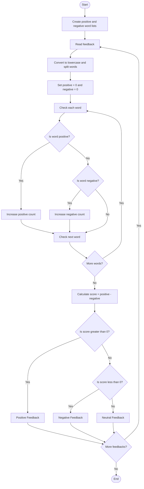

### Case Study 34: Student Feedback Sentiment Scoring

### 1\. Problem Statement

To analyze student feedback by counting positive and negative words, calculate a sentiment score, and classify the feedback as positive, negative, or neutral.

### 2\. Algorithm

* Create lists of positive and negative words.

* Store student feedback in a list.

* Read each feedback and convert it to lowercase.

* Split the feedback into individual words.

* Count positive and negative words.

* Calculate the sentiment score by subtracting negative words from positive words.

* Display the score and classify the feedback.

### 3\. Flowchart



### 4\. Python Source Code

```python

positive_words = ["good", "excellent", "helpful", "nice", "best"]
negative_words = ["bad", "poor", "boring", "worst", "difficult"]

feedbacks = [
    "The teacher is good and helpful",
    "The class is boring and difficult",
    "The teaching is excellent",
    "The subject is bad"
]

for feedback in feedbacks:
    positive = 0
    negative = 0

    words = feedback.lower().split()

    for word in words:
        word = word.strip(".,!?")

        if word in positive_words:
            positive += 1
        elif word in negative_words:
            negative += 1

    score = positive - negative

    print("\nFeedback:", feedback)
    print("Positive words:", positive)
    print("Negative words:", negative)
    print("Sentiment score:", score)

    if score > 0:
        print("Result: Positive Feedback")
    elif score < 0:
        print("Result: Negative Feedback")
    else:
        print("Result: Neutral Feedback")
```

### 5\. Sample Input

```text
1. The teacher is good and helpful
2. The class is boring and difficult
3. The teaching is excellent
4. The subject is bad
```

### 6\. Sample Output

```text

Feedback: The teacher is good and helpful
Positive words: 2
Negative words: 0
Sentiment score: 2
Result: Positive Feedback

Feedback: The class is boring and difficult
Positive words: 0
Negative words: 2
Sentiment score: -2
Result: Negative Feedback

Feedback: The teaching is excellent
Positive words: 1
Negative words: 0
Sentiment score: 1
Result: Positive Feedback

Feedback: The subject is bad
Positive words: 0
Negative words: 1
Sentiment score: -1
Result: Negative Feedback
```

### 7\. Explanation

* First feedback: 2 positive words − 0 negative words = 2 (Positive).

* Second feedback: 0 positive words − 2 negative words = −2 (Negative).

* Third feedback: 1 positive word − 0 negative words = 1 (Positive).

* Fourth feedback: 0 positive words − 1 negative word = −1 (Negative).

Remember:

* Score greater than 0 → Positive feedback.

* Score less than 0 → Negative feedback.

* Score equal to 0 → Neutral feedback.
